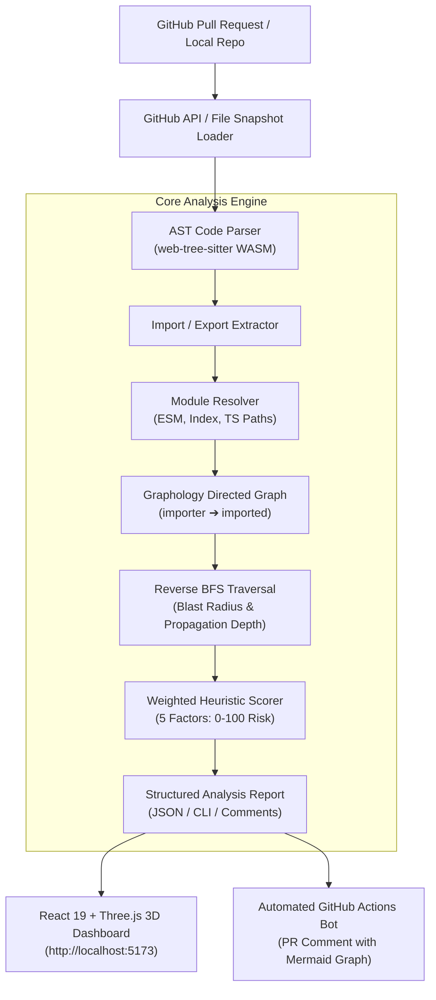

<div align="center">

# 🌊 Ripple · Pull Request Impact Radar

**Predict downstream code breakage and architectural blast radius before merge.**

[](https://www.typescriptlang.org/)
[](https://react.dev/)
[](https://threejs.org/)
[](https://tree-sitter.github.io/)
[](https://github.com/harsh200623/Ripple/actions)
[](https://opensource.org/licenses/MIT)

---

### *A normal GitHub API integration tells you which files changed.*
### *Ripple tells you what those changes might break across your entire repository.*

</div>

---

## 📸 Dashboard Preview


*Interactive Ripple Dashboard featuring real-time GitHub PR analysis, multi-hop blast radius metrics, 5-factor risk scoring breakdown, and the interactive 3D Orbit Dependency Graph.*

---

## 🎯 What is Ripple?

When developers submit pull requests, reviewers typically review line-by-line diffs. However, critical software regressions often occur not in the changed lines themselves, but in **indirect downstream consumers** that rely on modified function signatures, exported interfaces, or shared state.

**Ripple** is an explainable pull-request blast-radius analysis platform. It inspects pull requests, constructs a high-fidelity directed dependency graph of the repository using Abstract Syntax Tree (AST) parsing, conducts reverse graph traversals (BFS) to identify all directly and transitively affected files, and computes a transparent, heuristic risk score (0–100) before merge.

---

## ⚡ Core Capabilities

### 1. 🌲 AST Code Parsing (Tree-sitter WASM)
- Replaces brittle regex matching with genuine Abstract Syntax Tree extraction using WebAssembly Tree-sitter parsers (`tree-sitter-typescript`, `tree-sitter-javascript`, `tree-sitter-tsx`).
- Identifies exact `ImportDeclaration` sources, default/named specifiers, and namespace imports.
- Extracts `ExportDeclaration` symbols, exported functions, classes, and types.
- Tolerates incomplete or evolving PR syntax gracefully via resilient AST traversal and fallback heuristics.

### 2. 🧩 Intelligent Module Resolution
- Resolves relative file imports (`./`, `../`) across nested folder structures.
- Implements TypeScript ESM module mapping (e.g. resolving `import { foo } from './bar.js'` to `bar.ts` or `bar.tsx` on disk).
- Resolves directory index files (`index.ts`, `index.tsx`, `index.js`).
- Safely identifies non-code assets (`.css`, `.svg`, `.json`) without polluting error logs.

### 3. 💥 Reverse BFS Blast-Radius Traversal
- Uses **Graphology** to maintain directed file-level dependency graphs where edges represent `importer -> imported` relationships.
- Runs reverse Breadth-First Search (BFS) starting from changed files.
- Accurately classifies:
  - **Changed Files**: Directly modified in the PR.
  - **Directly Affected Files (`depth = 1`)**: Modules that immediately import changed files.
  - **Indirectly Affected Files (`depth >= 2`)**: Transitive dependents affected down the call-chain.
- Avoids infinite cycles and guarantees termination on complex cyclic import topologies.
- Changed files are isolated and never double-counted as affected files.

### 4. 🛡 Transparent 5-Factor Risk Scoring Model
Ripple does not output black-box numbers. It calculates an explainable heuristic risk score (0–100) and risk level (`LOW`, `MEDIUM`, `HIGH`, `CRITICAL`) using weighted architectural factors:

| Risk Dimension | Model Weight | Assessment Logic |
| :--- | :---: | :--- |
| **Blast Radius Volume** | **35%** | Scaled ratio of total affected files to changed files |
| **Propagation Depth** | **20%** | Maximum reverse dependency cascade depth (hops) |
| **Module Criticality** | **20%** | Sensitivity of modified paths (Auth, Billing, Security, Core Database) |
| **Change Volume** | **15%** | Total lines modified (additions + deletions) across the PR |
| **Test Coverage Verification** | **10%** | Presence of corresponding test updates for modified paths |

### 5. 🌐 Interactive 3D Orbit Dependency Graph
- Built with **Three.js** and **OrbitControls** with WebGL hardware acceleration.
- Visualizes the full blast radius:
  - 🔴 **Red Glowing Spheres**: Root modified files with pulsing halo rings.
  - 🟠 **Amber Spheres**: Directly affected first-hop dependents.
  - 🔵 **Indigo Spheres**: Transitive multi-hop indirect dependents.
  - ⚪ **Slate Spheres**: Unaffected repository context.
- Directional arrow cones showing dependency propagation flow.
- Canvas sprite text labels, click-to-inspect raycasting, auto-orbit camera rotation, and seamless 3D / 2D toggling.

### 6. 🤖 Automated GitHub Pull Request Bot
- Automatically triggers on pull requests (`opened`, `synchronize`, `reopened`) via GitHub Actions.
- Analyzes PR changes, generates a markdown report with metrics, risk score, factor breakdown, impacted files table, and a GitHub-rendered **Mermaid diagram**.
- Posts (or updates existing) comments directly on the pull request.
- Exclusively scoped to run on `harsh200623/Ripple` for security.

---

## 🏗 System Architecture & Workflow



---

## 📁 Repository Structure

```
Ripple/
├── .github/
│   └── workflows/
│       └── ripple-impact.yml          # Automated PR Impact Radar GitHub Action
├── docs/                              # Canonical project specifications
│   ├── assets/
│   │   └── ripple-dashboard.jpg       # High-res UI screenshot
│   ├── 01-project-overview.md
│   ├── 02-requirements.md
│   ├── 03-system-architecture.md
│   ├── 04-dependency-analysis.md
│   ├── 05-api-and-database.md
│   └── 06-frontend-specification.md
├── frontend/                          # React 19 + Vite + Three.js Dashboard
│   ├── src/
│   │   ├── components/
│   │   │   └── Graph3D.tsx            # Three.js 3D WebGL Dependency Graph
│   │   ├── App.tsx                    # HUD metrics, controls, file matrix
│   │   └── App.css                    # Modern dark glassmorphism styling
│   └── package.json
├── scripts/
│   └── pr-bot.ts                      # Standalone GitHub PR Comment Bot
├── src/
│   ├── domain/
│   │   ├── analysis/                  # Person 2 Core Engine Deliverables
│   │   │   ├── parser/
│   │   │   │   ├── ast-parser.ts      # Tree-sitter AST parser
│   │   │   │   └── file-types.ts      # Extension and path normalization
│   │   │   ├── resolver/
│   │   │   │   └── module-resolver.ts # TypeScript / ESM path resolution
│   │   │   ├── graph/
│   │   │   │   └── dependency-graph.ts# Graphology directed graph builder
│   │   │   ├── blast-radius/
│   │   │   │   └── traversal.ts       # Reverse BFS blast-radius engine
│   │   │   ├── scoring/
│   │   │   │   └── risk-scorer.ts     # 5-factor weighted risk heuristic
│   │   │   ├── warnings/
│   │   │   │   └── warning-collector.ts
│   │   │   ├── analyzer.ts            # Standalone analyzeRepository entrypoint
│   │   │   └── types.ts               # Core domain interfaces
│   │   └── github/
│   │       └── github-fetcher.ts      # Live GitHub PR and Git tree client
│   └── server.ts                      # Express API backend
├── tests/                             # Vitest comprehensive unit test suite
│   ├── analyzer.test.ts
│   ├── blast-radius.test.ts
│   ├── parser.test.ts
│   ├── resolver.test.ts
│   └── scoring.test.ts
└── package.json
```

---

## 🚀 Quick Start Guide

### Prerequisites
- **Node.js**: v20 or v22+
- **Git**

### 1. Installation
Clone the repository and install dependencies for both the backend and frontend:

```bash
# Clone repository
git clone https://github.com/harsh200623/Ripple.git
cd Ripple

# Install root backend dependencies
npm install

# Install frontend dependencies
cd frontend
npm install
cd ..
```

### 2. Start the API Backend
The Express API runs on port `3001`:

```bash
npm run server
```
*Health check endpoint:* `http://localhost:3001/api/v1/health`

### 3. Start the Interactive Dashboard
Launch Vite dev server on port `5173`:

```bash
cd frontend
npm run dev
```
Open **[http://localhost:5173](http://localhost:5173)** in your browser to inspect sample scenarios or paste real GitHub PR URLs!

---

## 🤖 Running the PR Impact Bot

You can run the PR bot locally or in CI to generate automated impact comments:

```bash
# Analyze a PR on harsh200623/Ripple and post an impact comment
npx tsx scripts/pr-bot.ts --pr 3

# Or analyze by full GitHub URL
npx tsx scripts/pr-bot.ts --pr https://github.com/harsh200623/Ripple/pull/3
```

When run in GitHub Actions, the workflow `.github/workflows/ripple-impact.yml` automatically executes on all PR opens and synchronizations.

---

## 🧪 Testing & Verification

Ripple includes a comprehensive Vitest test suite covering AST parsing, module resolution, reverse graph traversal, and risk scoring:

```bash
# Run all unit tests
npm test

# Typecheck backend
npm run typecheck

# Typecheck and build frontend
cd frontend
npm run build
```

---

## 📜 License

Distributed under the **MIT License**. See `LICENSE` for details.
