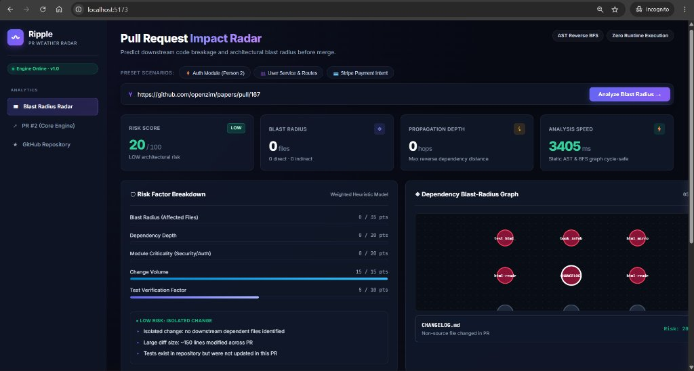
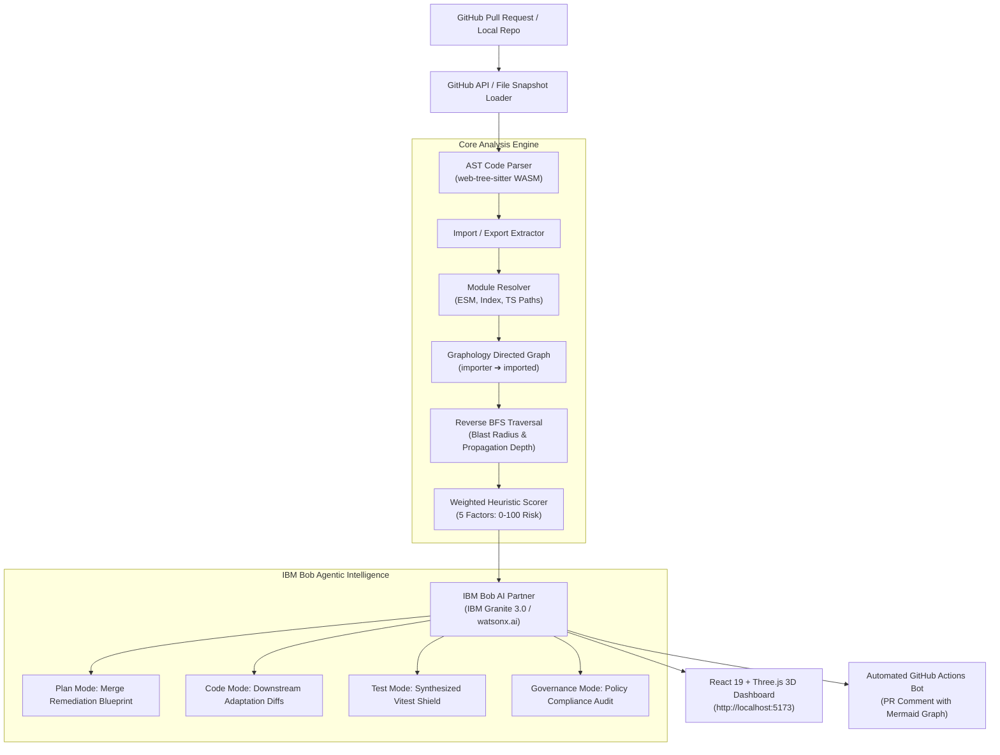

<div align="center">

# 🌊 Ripple · Pull Request Impact Radar
### *Powered by **IBM Bob AI Partner (IBM Granite 3.0)***

**Predict downstream code breakage and autonomously remediate architectural blast radius before merge.**

[-0f62fe.svg?style=for-the-badge&logo=ibm)](https://www.ibm.com)
[](https://www.typescriptlang.org/)
[](https://react.dev/)
[](https://threejs.org/)
[](https://tree-sitter.github.io/)
[](https://github.com/harsh200623/Ripple/actions)
[](https://opensource.org/licenses/MIT)

---

### *A normal GitHub API integration tells you which files changed.*
### *Ripple detects what those changes might break across your entire repository.*
### *And IBM Bob autonomously synthesizes the code patches & tests to fix it.*

</div>

---

## 📸 Dashboard Preview



*Interactive Ripple Dashboard featuring real-time GitHub PR analysis, multi-hop blast radius metrics, 5-factor risk scoring breakdown, the interactive 3D Orbit Dependency Graph, and the **IBM Bob AI Agent Hub**.*

---

## 🎯 What is Ripple & Why IBM Bob?

When developers submit pull requests, reviewers review line-by-line diffs in isolation. However, **over 80% of critical regressions occur in indirect downstream consumers** that rely on modified function signatures, exported interfaces, or shared state.

**Ripple** operates as an intelligent **PR Weather Radar**:
1. It parses the codebase using **Tree-sitter ASTs** to construct a directed dependency graph.
2. It executes **Reverse BFS traversal** to calculate the downstream blast radius and propagation depth.
3. It computes an explainable **5-factor risk score (0–100)** before merge.

### 🤖 The Centerpiece: IBM Bob Agentic Developer
A radar that only alerts you to incoming trouble is only half the battle. **IBM Bob (powered by IBM Granite 3.0 / watsonx.ai)** transforms Ripple into an autonomous, proactive remediation platform:

- **📋 Plan Mode (Architectural Blueprint):** Bob analyzes the AST delta, determines the risk propagation path, and generates a structured, multi-step merge mitigation plan for reviewers.
- **🛠 Code Mode (Autonomous Downstream Patches):** When a modified file threatens downstream consumers, Bob synthesizes defensive code adaptation patches and diffs to shield dependent files from upstream signature breakages.
- **🛡 Test Mode (Automated Regression Shield):** Bob automatically generates a comprehensive Vitest / Jest test suite targeting every affected downstream call-site to mathematically prove zero runtime breakage before merging.
- **💬 Ask Mode (Interactive AI Copilot):** Developers can query Bob directly inside the 3D dashboard (*"Why is orders.js affected?", "How do I make auth.js backwards-compatible?"*) and receive contextual architectural explanations and code snippets.
- **🏛 Enterprise Governance & Policy Audit:** Evaluates backwards compatibility, blast radius confinement, and compliance criteria before sign-off.

---

## ⚡ Core Capabilities

### 1. 🤖 IBM Bob Agentic Remediation Hub
- **Multi-Mode Agentic Workflow:** Supports *Plan*, *Code*, *Test*, and *Ask* modes out of the box.
- **One-Click Diff Generation:** View side-by-side git diff patches designed to safeguard downstream consumers.
- **Synthesized Test Suites:** Export ready-to-run regression tests targeting the exact blast-radius boundary.
- **Interactive In-Browser Assistant:** Real-time reasoning about refactoring strategies and deployment risks.

### 2. 🌲 AST Code Parsing (Tree-sitter WASM)
- Genuine Abstract Syntax Tree extraction using WebAssembly Tree-sitter parsers (`tree-sitter-typescript`, `tree-sitter-javascript`, `tree-sitter-tsx`).
- Identifies exact `ImportDeclaration` sources, default/named specifiers, and namespace imports.
- Extracts `ExportDeclaration` symbols, exported functions, classes, and types with zero runtime execution.

### 3. 🧩 Intelligent Module Resolution
- Resolves relative file imports (`./`, `../`) across nested folders.
- Implements TypeScript ESM module mapping (`.js` $\rightarrow$ `.ts` / `.tsx`).
- Directory index file resolution (`index.ts`, `index.tsx`, `index.js`).
- Safely isolates non-code assets (`.css`, `.svg`, `.json`).

### 4. 💥 Reverse BFS Blast-Radius Traversal
- Uses **Graphology** to maintain directed file-level dependency graphs where edges represent `importer -> imported` relationships.
- Runs reverse Breadth-First Search (BFS) starting from changed files.
- Separates:
  - **Changed Files:** Directly modified in the PR.
  - **Directly Affected Files (`depth = 1`):** Modules that immediately import changed files.
  - **Indirectly Affected Files (`depth >= 2`):** Transitive dependents affected down the call-chain.

### 5. 🛡 Transparent 5-Factor Risk Scoring Model
Ripple outputs an explainable heuristic risk score (0–100) and risk level (`LOW`, `MEDIUM`, `HIGH`, `CRITICAL`):

| Risk Dimension | Model Weight | Assessment Logic |
| :--- | :---: | :--- |
| **Blast Radius Volume** | **35%** | Scaled ratio of total affected files to changed files |
| **Propagation Depth** | **20%** | Maximum reverse dependency cascade depth (hops) |
| **Module Criticality** | **20%** | Sensitivity of modified paths (Auth, Billing, Security, Core Database) |
| **Change Volume** | **15%** | Total lines modified (additions + deletions) across the PR |
| **Test Coverage Verification** | **10%** | Presence of corresponding test updates for modified paths |

### 6. 🌐 Interactive 3D Orbit Dependency Graph
- Hardware-accelerated **Three.js WebGL** scene with **OrbitControls**.
- Glowing color-coded nodes:
  - 🔴 **Red Glowing Spheres:** Root modified files with pulsing halo rings.
  - 🟠 **Amber Spheres:** Directly affected first-hop dependents.
  - 🔵 **Indigo Spheres:** Transitive multi-hop indirect dependents.
  - ⚪ **Slate Spheres:** Unaffected repository context.
- Directional arrow cones indicating dependency propagation flow.
- Canvas sprite text labels, click-to-inspect raycasting, auto-rotation, and 3D / 2D toggles.

### 7. 🤖 Automated GitHub Pull Request Bot
- Automatically triggers on pull requests (`opened`, `synchronize`, `reopened`) via GitHub Actions.
- Comments with a compact HUD table, **IBM Bob's architectural remediation verdict**, collapsible file breakdown, and interactive **Mermaid dependency diagrams**.
- Includes a direct deep-link to launch the interactive 3D dashboard for that exact PR.

---

## 🏗 System Architecture & Workflow



---

## 🚀 Quick Start Guide

### Prerequisites
- **Node.js**: v20 or v22+
- **Git**

### 1. Installation
Clone repository and install dependencies:

```bash
git clone https://github.com/harsh200623/Ripple.git
cd Ripple

# Install dependencies (root + frontend)
npm run build
```

### 2. Start the API & IBM Bob Backend
The Express server runs on port `3001` (or `$PORT` in production):

```bash
npm run server
```
*Health check:* `http://localhost:3001/api/v1/health`

### 3. Launch the Interactive Dashboard
Launch Vite dev server on port `5173`:

```bash
cd frontend
npm run dev
```
Open **[http://localhost:5173](http://localhost:5173)** in your browser!

---

## 🤖 Running the PR Impact Bot

Run the bot locally or in CI/CD pipelines:

```bash
# Analyze PR on harsh200623/Ripple and post an impact comment
npx tsx scripts/pr-bot.ts --pr 3

# Or analyze by full URL
npx tsx scripts/pr-bot.ts --pr https://github.com/harsh200623/Ripple/pull/3
```

---

## 🧪 Testing & Verification

Ripple includes a comprehensive Vitest test suite covering AST parsing, module resolution, reverse graph traversal, and risk scoring:

```bash
# Run all unit tests
npm test

# Typecheck backend
npm run typecheck

# Build frontend & backend
npm run build
```

---

## 📜 License

Distributed under the **MIT License**. See `LICENSE` for details.
